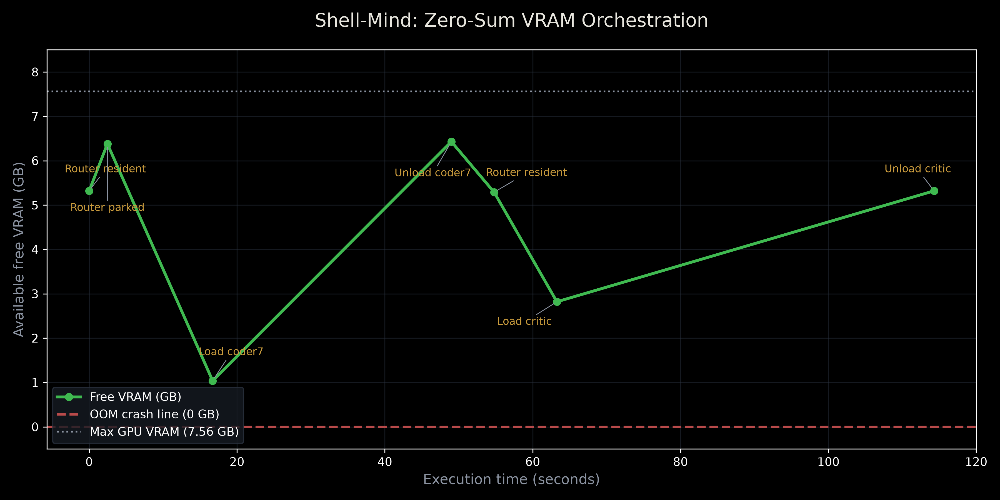

# ⚡ Shell-Mind

[](https://github.com/momoinuddin-ali/shell-mind/actions/workflows/test.yml)

**Zero-Sum VRAM Orchestrated Multi-Agent Local AI Workstation**

Shell-Mind is a **self-hosted** multi-tier AI workstation: you clone the repo, run the backend on *your* machine (or a company GPU box), and use the web UI or CLI from that same machine or from other devices you control.

It is designed to run complex software-engineering and multi-agent workflows on a strict **8 GB VRAM** budget (NVIDIA RTX 5050 / 4060 / 3060 class) — and the same zero-sum engine scales up when more VRAM is available by swapping in larger models via `models.json`.

Unlike single-shot chatbot wrappers, Shell-Mind treats GPU memory as a scarce resource. It dynamically loads and unloads specialized models so that only the models required for the current stage of a request occupy VRAM at any time. That is what makes a full Router → Vision → Coder/Reasoner → Critic pipeline fit on 8 GB instead of OOMing.

```
User
 │
 ├── Web Interface (frontend/)
 └── Terminal Client (cli.py)
          │
          ▼
   FastAPI Server (primary_node/ai_core.py)
          │
    ┌─────┴─────┬──────────────┐
    │           │              │
 File Uploads  Doc Context   CPU / GPU Copilot
    │           │              │
    └─────┬─────┘              │
          │                    │
          ▼                    │
   Agent Engine                │
   (workstation/orchestrator.py)│
          │                    │
   ┌──────┼──────┬──────┐      │
   │      │      │      │      │
 Router Vision Coder Critic    │
   │      │      │      │      │
   └──────┴──────┴──────┘      │
          │                    │
          ▼                    ▼
   Model Zoo + Audit Log (SQLite)
          │
          ▼
   Local Quantized Weights (4-bit NF4)
```

---

## Core Idea — Zero-Sum VRAM Orchestration

On an 8 GB card you cannot keep a 7–8 B model, a vision model, and a critic resident at the same time. Shell-Mind therefore enforces a **zero-sum** contract:

| Stage              | What lives in VRAM                          | What is parked / unloaded      |
|--------------------|---------------------------------------------|-------------------------------|
| Router planning    | 1.5 B router only                           | everything else               |
| Vision             | 8 B VLM                                     | router parked                 |
| Code / Reasoning   | 7 B coder or 8 B thinker                    | router parked                 |
| Critic             | 4 B critic + 1.5 B router (they coexist)    | workers unloaded              |
| GPU Copilot mode   | single 7 B instruct model                   | agent models unloaded         |
| CPU Lite mode      | 0.5 B model on CPU                          | GPU free                      |

VRAM is measured live around every load (`torch.cuda.mem_get_info()`) and recorded to a timeline. Load failures (OOM, broken quantization path) **purge** VRAM and fall back along a registered chain (`coder30 → coder7`); workers without a registered fallback fail gracefully — the request gets a clean error, VRAM is purged, and the server keeps running.

**The measured price of this contract:** a 7 B model swap costs ~16 s on the RTX 5050, with smaller models (1.5 B router, 4 B critic) loading proportionally faster — so a full agent run typically takes 1–3 minutes. That is the trade-off that makes a 6-model pipeline fit on an 8 GB card at all — swap latency instead of OOM.




*Regenerate after a smoke/agent run: `python vram_chart.py --out portfolio_vram_chart.png`. Fresh clones may omit the PNG until you generate it.*

*Live trace from `vram_timeline.json` (rendered by `vram_chart.py`). Each valley is a specialist in residence; the peaks near 6.4 GB are the freed states between stages — the unload returns free VRAM to within ~0.1 GB of baseline every time.*

---

## Three-Tier Compute Engine

1. **CPU Lite (Tier 1)**
   Qwen2.5-0.5B-Instruct on CPU (fp32, ~1 GB RAM). Used automatically when no GPU is present, or on demand — selecting `cpu` mode on a GPU machine keeps the GPU completely free.

2. **GPU Copilot (Tier 2)**
   A single 7 B instruct model (Qwen2.5-Coder-7B-Instruct, 4-bit NF4) holds the GPU. Standard chat, coding help, and document-context questions.

3. **Agent Workstation (Tier 3)**
   Full multi-agent pipeline for hard requests:

   ```
   Router (1.5 B)
        ↓
   [optional Vision Specialist]
        ↓
   ONE specialist worker
        • Code   → Qwen2.5-Coder-7B (30 B MoE behind a flag, see registry)
        • Reasoning → Qwen3-8B
        • Vision-only → summary becomes the draft
        ↓
   Final Critic (4 B)
        ↓
   Answer returned to user
   ```

All tiers load **lazily on first use** — the server starts serving `/health` within seconds; the first prompt of each tier pays the model-load cost.

---

## Key Features

| Feature | Implementation |
|---------|----------------|
| **Zero-Sum VRAM** | Live `torch.cuda.mem_get_info()` around every load, forced unload + `gc` + `empty_cache`, every swap recorded on a timeline |
| **Graceful degradation** | OOM / quant failures → purge → fallback chain (`coder30 → coder7`) → continue; un-routable requests (e.g. vision-only without the vision model) refuse honestly instead of guessing |
| **RAG Lite** | PDF: first 3 pages; TXT/CSV: first 3 000 chars — injected into the prompt, no vector DB required |
| **Vision** | Qwen3-VL-8B processes screenshots / images; output becomes compact context for the text workers |
| **Audit logging** | Every prompt, mode, attached file and response appended to `shell_mind_history.db` (SQLite) |
| **Hardened uploads** | Extension whitelist + 25 MB cap + UUID filenames; `/chat` only opens files the server itself issued |
| **Smoke tests** | `python -m workstation.smoke_test` verifies load → generate → unload → VRAM actually freed |
| **VRAM timeline** | Pipeline dumps `vram_timeline.json`; `vram_chart.py` produces a portfolio-ready chart |
| **Decoupled clients** | Vanilla HTML/CSS/JS glassmorphism UI + independent terminal CLI (uploads images itself, works cross-machine) |
| **Thread history** | Client-side `localStorage` threads; server-side append-only SQLite log for academic review. Requests themselves are stateless — there is no server-side conversation memory (yet) |

---

## Model Registry

All models are 4-bit NF4 (bitsandbytes) except vision towers (bf16).

| Key       | Hugging Face ID                        | Role     | Approx. VRAM | Notes                                                     |
|-----------|----------------------------------------|----------|--------------|-----------------------------------------------------------|
| `router`  | Qwen/Qwen2.5-1.5B-Instruct             | Router   | ~1.2 GB      | Resident between stages; parked while heavy workers run    |
| `coder7`  | Qwen/Qwen2.5-Coder-7B-Instruct         | Coder    | ~5.2 GB      | Production coder                                           |
| `coder30` | Qwen/Qwen3-Coder-30B-A3B-Instruct      | Coder    | —            | **Disabled by default** — see note below                   |
| `thinker` | Qwen/Qwen3-8B                          | Reasoner | ~5.5 GB      | Step-by-step thinking                                      |
| `critic`  | Qwen/Qwen3-4B-Instruct-2507            | Critic   | ~3.0 GB      | Coexists with router                                       |
| `vision`  | Qwen/Qwen3-VL-8B-Instruct              | Vision   | ~6.0 GB      | Parks router while active                                  |
| `cpu05`   | Qwen/Qwen2.5-0.5B-Instruct             | Copilot  | 0 GB (CPU)   | CPU Lite tier, fp32 on CPU                                 |

**Why `coder30` is disabled:** bitsandbytes keeps CPU-offloaded MoE experts in fp32 (~75 GB of RAM for this model), so the planned GPU+DDR5 split is impractical with the bnb backend. The 7 B model is the production coder until the GGUF/llama.cpp backend lands (see Future Work). The registry entry, fallback wiring and smoke-test target remain so the integration is a flag-flip once the backend exists.

---

## Custom models (models.json)

**You run Shell-Mind.** There is no hosted “our server / your client” product —
the process on the GPU machine *is* your backend. The browser and CLI are just
frontends to that same process (on localhost or over Tailscale).

**There is no model picker in the GUI in v1.** You choose models once, on the
machine that holds the GPU, by editing a config file. That keeps multi-GB
downloads and VRAM limits explicit and under your control.

### How to fit models to *your* hardware

```bash
cp models.example.json models.json   # gitignored
# edit models.json — set any Hugging Face hf_id per role
# restart the backend
```

- **8 GB card (default story):** keep same-size-class models (~0.5B–8B quantized). The zero-sum engine already runs the full agent pipeline on this budget.
- **12–24 GB card:** point `code` / `reasoning` / `copilot_gpu` at larger HF IDs in `models.json`.
- **CPU-only machine:** use `cpu` mode; map `copilot_cpu` as needed.

Example — smaller coder on a tight card:

```json
{
  "models": {
    "mycoder": {
      "hf_id": "Qwen/Qwen2.5-Coder-3B-Instruct",
      "vram_gb": 2.5,
      "fallback": "coder7"
    }
  },
  "roles": {
    "code": "mycoder",
    "copilot_gpu": "mycoder",
    "router": "router",
    "reasoning": "thinker",
    "critic": "critic",
    "vision": "vision",
    "copilot_cpu": "cpu05"
  }
}
```

Valid roles: `router`, `vision`, `code`, `reasoning`, `critic`,
`copilot_gpu`, `copilot_cpu`.

**Download behavior:** on first request that needs a role, Hugging Face
`from_pretrained` pulls weights into `models/hf_cache/` if missing. Preload
if you do not want the first chat to wait:

```bash
python -c "from huggingface_hub import snapshot_download; snapshot_download('Qwen/Qwen2.5-Coder-3B-Instruct')"
```

Invalid entries are ignored with a warning; a custom model not yet in the
cache falls back to the built-in default for that role so chat does not
hard-crash. Oversized picks still hit physics — OOM or fallback.

A future Settings UI (paste HF ID → download with progress) is optional
product polish; see Future Work.

---

> Architecture diagram below is schematic (fixed-width). See the component tree for the authoritative file layout.

## Architecture (Component View)

```
shell-mind/
├── primary_node/
│   └── ai_core.py          # FastAPI server: tiers, uploads, RAG-lite, audit log
├── workstation/
│   ├── model_zoo.py        # Loading layer, VRAM accounting, fallback chain
│   ├── router.py           # 1.5 B planner → strict JSON plan
│   ├── orchestrator.py     # State machine: plan → vision → worker → critic
│   ├── agents.py           # see / code / think / critique (wake → work → sleep)
│   ├── paths.py            # Single source of truth for all filesystem locations
│   └── smoke_test.py       # Hardware acceptance tests
├── frontend/
│   ├── index.html
│   ├── style.css           # Dark glassmorphism UI
│   └── script.js           # Threads, attachments, neural loader
├── tests/
│   │   └── test_server_contract.py   # 28 API contract tests — run GPU-less on any machine
├── cli.py                  # Thin terminal client (never loads models)
├── vram_chart.py           # Portfolio chart from vram_timeline.json
├── requirements.txt
├── CHANGES.md              # Hardening changelog: every fix, before → after
└── README.md
```

All runtime artifacts (`models/`, `uploads/`, `offload_cache/`, the audit DB, the timeline) are anchored to the repo root via `workstation/paths.py`, so the server behaves the same regardless of where it is launched from. `SHELL_MIND_MODELS_DIR` and `SHELL_MIND_DB` environment variables override the default locations.

---

## Quick Start & useful commands

### Requirements

- Python 3.10+
- NVIDIA GPU with ≥ 8 GB VRAM (or CPU-only fallback)
- CUDA 12+ / PyTorch with CUDA
- ~60 GB free SSD for the enabled models' HF cache (~120 GB if you also fetch the disabled 30B coder)

### A. First-time install (machine that will run models)

```bash
git clone https://github.com/momoinuddin-ali/shell-mind.git
cd shell-mind
python -m venv .venv
source .venv/bin/activate          # Windows: .venv\Scripts\activate
pip install -r requirements.txt
```

---

### B. Scenario: local only (same PC, browser on localhost)

Simplest path — no Tailscale, no API key required on a trusted machine:

```bash
source .venv/bin/activate
uvicorn primary_node.ai_core:app --host 127.0.0.1 --port 8000
```

Open **http://localhost:8000** — the backend serves the UI itself (one terminal).

- `127.0.0.1` = only this machine
- `0.0.0.0` = all interfaces (use an API key on shared Wi-Fi)

---

### C. Scenario: phone / other devices via Tailscale (recommended daily use)

**On the GPU machine (once):**

```bash
# Tailscale must be up: sudo tailscale up
./setup.sh          # choose 1) Server
# writes .env (API key + rate limits) and run-server.sh bound to your tailnet IP
./run-server.sh     # preferred day-to-day start — wraps uvicorn for you
```

You do **not** need to type `uvicorn` yourself when using `./run-server.sh`.

**On phone / second laptop (same Tailscale account):**

- Browser: open `http://<tailscale-ip>:8000` (printed by `run-server.sh`)
- Enter the API key when prompted (from setup output or `.env`)
- Or use the CLI on another machine:

```bash
./setup.sh          # choose 2) Client — saves server URL + key to .env
python cli.py
```

**Android (Termux):** install the Tailscale app (same account), then  
`pkg install python git && pip install requests`, clone this repo,  
`python cli.py` → option 1 → server IP. Run `termux-wake-lock` before long agent runs.

Same idea at company scale: one GPU box runs the backend; staff devices are thin frontends on the tailnet. Size models to that box with `models.json`.

---

### D. Scenario: manual Tailscale bind (without setup.sh)

```bash
export SHELL_MIND_API_KEY="$(python3 -c 'import secrets; print(secrets.token_urlsafe(24))')"
uvicorn primary_node.ai_core:app --host $(tailscale ip -4) --port 8000
```

---

### E. Useful commands cheat sheet

| Goal | Command |
|------|---------|
| Start after setup | `./run-server.sh` |
| Start local only | `uvicorn primary_node.ai_core:app --host 127.0.0.1 --port 8000` |
| Start on all interfaces | `uvicorn primary_node.ai_core:app --host 0.0.0.0 --port 8000` |
| Start Tailscale-only (manual) | `uvicorn primary_node.ai_core:app --host $(tailscale ip -4) --port 8000` |
| Rotate API key | `./setup.sh` → choose **3** → restart server |
| CLI interactive | `python cli.py` |
| CLI one-shot agent | `python cli.py --mode agent "fix this: ValueError: ..."` |
| CLI + screenshot | `python cli.py --mode agent --image shot.png "what is wrong?"` |
| CLI with API key | `python cli.py --key "$SHELL_MIND_API_KEY"` |
| Custom HF models | `cp models.example.json models.json` → edit → restart |
| Preload a model | `python -c "from huggingface_hub import snapshot_download; snapshot_download('ORG/MODEL')"` |
| Offline HF (after cache warm) | add `HF_HUB_OFFLINE=1` to `.env`, then `./run-server.sh` |
| Smoke test (GPU) | `python -m workstation.smoke_test` |
| Smoke test all models | `python -m workstation.smoke_test all` |
| Contract tests (no GPU) | `python tests/test_server_contract.py` |
| VRAM chart | `python vram_chart.py` or `python vram_chart.py --last 22` |
| Health JSON | `curl -s http://127.0.0.1:8000/health` |

**Modes (UI dropdown or `--mode`):** `cpu` (0.5B, GPU free) · `gpu` (7B copilot) · `agent` (full pipeline).

---

### F. `.env` knobs (optional)

Created by `./setup.sh`; edit by hand if you want:

```bash
SHELL_MIND_API_KEY=...          # require X-API-Key on chat/upload
SHELL_MIND_RATE_LIMIT=20        # max requests per window per IP
SHELL_MIND_RATE_WINDOW=60       # window length in seconds
HF_HUB_OFFLINE=1                # after models are cached — skip HF network checks
SHELL_MIND_MODELS_DIR=/path     # override model cache root
SHELL_MIND_DB=/path/to.db       # override audit DB path
```

`./run-server.sh` sources `.env` automatically. A bare `uvicorn` command only sees variables you exported in that shell (or run `set -a; source .env; set +a` first).

---

### G. What the server log means (normal behavior)

| Log line | Meaning |
|----------|---------|
| `GET /health 200` | UI/phone status poll — does **not** cancel model loads |
| `GET / 304` / `script.js 304` | Browser still has a valid cached copy — not an error |
| `Loading weights` then `GET /health` | Concurrent poll during load — pipeline continues |
| `worker unloaded \| X GB VRAM free` | Zero-sum unload working |
| `POST /chat 200` | Request finished successfully |
| `POST /chat 401` | Missing or wrong API key |
| `429` / `503` | Rate limit or server busy — retry shortly |

---

### H. Stop / restart

```bash
# in the server terminal
Ctrl+C
./run-server.sh          # or your uvicorn line again
```

Restart after changing `models.json`, `.env`, or Python under `workstation/` / `primary_node/`.  
Frontend-only edits (`frontend/*`) usually apply after a hard browser refresh (no process restart).

---

## API Surface

| Method | Endpoint          | Purpose                                      |
|--------|-------------------|----------------------------------------------|
| GET    | `/health`         | Status, current tier, GPU flag, free VRAM    |
| POST   | `/chat`           | Main inference (`mode`: `cpu` / `gpu` / `agent`) |
| POST   | `/upload`         | Store a document (PDF/TXT/CSV) for RAG-Lite context |
| POST   | `/upload_image`   | Store an image for the vision specialist     |

Example request:

```json
{
  "prompt": "Write a bash one-liner that finds the 10 largest files",
  "mode": "agent",
  "document_path": null,
  "image_path": null
}
```

**Upload rules.** Uploads are capped at 25 MB and restricted to `.pdf .txt .csv .jpg .jpeg .png .gif`; the server stores them under UUID names in `uploads/` and returns the server-side path. `/chat` accepts **only** those server-issued paths — arbitrary filesystem paths are rejected with HTTP 400. Stale uploads are purged after 24 h. Rejections return proper status codes: `413` (too large), `415` (bad type), `400`/`404` (bad/expired path), `422` (invalid mode).

**Optional API key.** Start the server with `SHELL_MIND_API_KEY=<shared-secret>` to require an `X-API-Key` header on `/chat`, `/upload` and `/upload_image` (invalid/missing key → `401`; `/health` stays open). The web UI prompts for the key once and remembers it locally (forget it via **Clear All Data**); the CLI takes `--key` or the same environment variable. Leave the variable unset for open access inside a private tailnet.

**Security note.** With `--host 0.0.0.0` the server listens on every interface and by default has **no authentication** — anyone who can reach the port can use the models. Fedora's default `FedoraWorkstation` firewall zone even allows inbound connections on high ports (1025–65535) from the LAN, so on shared Wi-Fi that means everyone on the network. Defenses, in order of strength:

1. Bind to the Tailscale interface only: `--host $(tailscale ip -4)` — the tailnet becomes the sole entry point.
2. Set `SHELL_MIND_API_KEY` so even reachable parties need the shared key.
3. Both, for a two-layer boundary (recommended on shared networks).

Also: path validation prevents `/chat` from reading arbitrary files; uploaded files are parsed only by pypdf/PIL and never executed; total upload storage is capped (500 MB) and stale files purge after 24 h; every interaction is logged with the client's address. If a tailnet device (e.g. a phone) is lost, remove it from the [Tailscale admin console](https://login.tailscale.com/admin/machines) — access dies instantly. The audit database stores prompts/responses in plaintext on the server; treat laptop disk access as equivalent to full history access.

---

## Verification & Evaluation

```bash
# Fast smoke test — needs the GPU (router + critic + coder7)
python -m workstation.smoke_test

# Full model set
python -m workstation.smoke_test all

# API contract tests — NO GPU or model weights needed, runs on any machine
python tests/test_server_contract.py

# After any agent run, generate the VRAM chart
python vram_chart.py                  # whole last session
python vram_chart.py --last 22        # zoom on the last 22 samples
```

The smoke test asserts that each model can load, generate, unload, and actually free VRAM (within a 1.5 GB CUDA-context tolerance), plus a router+critic coexistence check — the core architecture claim.

The contract suite (28 tests, torch/transformers stubbed) locks in the security and API rules on any laptop in seconds: upload whitelist/cap, path validation (only server-issued paths accepted), status codes (413/415/400/404/422), RAG context injection, and audit-log appends. It catches regressions the stubs can't see — real CUDA/OOM behavior is the smoke test's job on the hardware.

---

## Hardware & Software Stack

**Minimum hardware**

- CPU: multi-core x86_64 (i7 / Ryzen 7 class)
- RAM: 16 GB DDR4/DDR5
- GPU: 8 GB VRAM (RTX 3060 / 4060 / 5050)
- Storage: ~60 GB SSD for the enabled models' HF cache (~120 GB if you also fetch the disabled 30B coder) — NVMe preferred

**Software**

- Python 3.10+, FastAPI, Uvicorn
- PyTorch (CUDA 12+), Hugging Face Transformers, bitsandbytes
- SQLite3
- Vanilla HTML5 / CSS3 / ES6 (no framework)

---

## Applications

- **Local code copilot** — free, privacy-preserving, offline assistant for developers
- **VRAM-constrained agent research** — demonstrates multi-agent workflows on consumer GPUs
- **Document-aware Q&A** — PDF/TXT/CSV context injection without a heavy vector store
- **Academic auditing** — append-only SQLite log of every interaction for project evaluation

---

## Limitations & Engineering Constraints

Stated honestly, because they shaped the design:
- **Sequential swap latency** — a 7 B model load costs ~16 s on the RTX 5050, with smaller models loading proportionally faster; agent runs take minutes, not seconds. No streaming yet (planned).
- **No streaming** — responses arrive only when generation completes.
- **No server-side conversation memory** — each request is independent; threads live in the client's `localStorage`.
- **Single user / single worker** — one GPU owner, one uvicorn worker; requests serialize on a generation lock.
- **Shared-key auth, not per-user** — `SHELL_MIND_API_KEY` gates *access*; the audit log attributes clients by IP, not by identity.
- **30 B MoE integration parked** — disabled behind `CODER30_ENABLED` pending a GGUF backend (bitsandbytes fp32-offload makes the GPU+RAM split impractical).
- **Plaintext audit log at rest** — interaction history is readable by anyone with disk access to the server machine.

---

## Future Work

- [ ] GGUF / llama.cpp backend for true CPU offload of MoE experts (unlocks `coder30`)
- [ ] Streaming responses via WebSockets or Server-Sent Events
- [ ] Full vector RAG (Chroma / FAISS) for larger document collections
- [ ] Server-side conversation memory across turns and sessions
- [ ] Function-calling / web-search tool agents
- [ ] Optional Settings UI: map roles → Hugging Face IDs and preload downloads with progress

---

## Team

| Name                 | Role                          | Roll No. |
|----------------------|-------------------------------|----------|
| Mo Moinuddin Ali     | Systems & Orchestration       | 63       |
| Md Imtiyaz           | Backend & Model Zoo           | 61       |
| Mohammad Ayaan       | Frontend & CLI                | 64       |
| Himanshu Verma       | Frontend & CLI                | 23       |

**Institution:** Shri Shankaracharya Technical Campus, Bhilai
**Department:** Computer Science & Engineering (AI & ML)
**Guide:** Dr. Jaspal Bagga, HOD (AIML)
**Session:** September – October 2026 (3rd Semester Mini-Project)

---

## Docs in this repo

- [`SYNOPSIS.md`](SYNOPSIS.md) — official mini-project synopsis (sequential zero-sum, current stack)
- [`CHANGES.md`](CHANGES.md) — development timeline and hardening history
- [`SECURITY.md`](SECURITY.md) — API key rotation, Tailscale, rate limits
- [`models.example.json`](models.example.json) — template for custom HF models

## License

Released under the [MIT License](LICENSE).
Model weights keep their upstream licenses (Qwen models: Apache 2.0) — quantized copies are loaded locally at runtime.

---

**Shell-Mind** — complex multi-agent AI, zero cloud, 8 GB VRAM.
